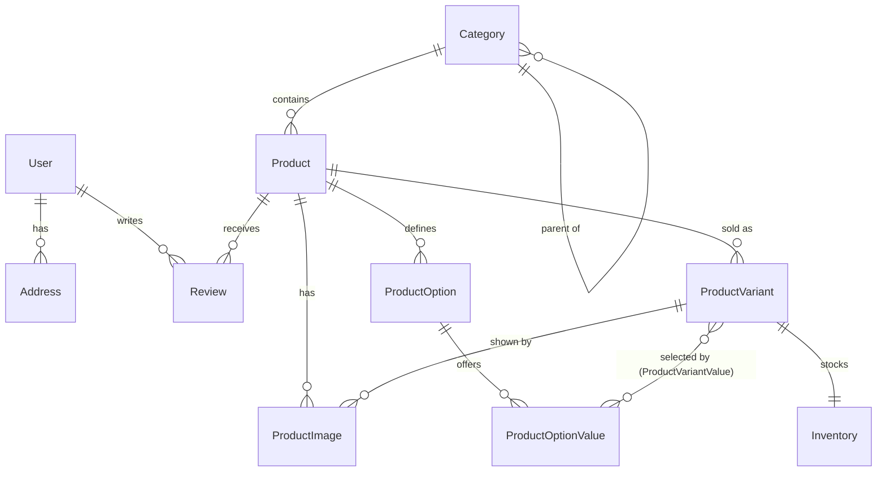

# Madhuyamini — Data Model

Status: **Approved and implemented, 31 Oct 2026.** Schema: `prisma/schema.prisma`; constraints: `prisma/migrations/20261031103938_init_catalog_and_customers/migration.sql`.

Scope of this phase: User, Address, Category, Product (with options), ProductImage, ProductVariant, Inventory and Review. Sessions (Phase 4, [auth.md](auth.md)) and carts and wishlists (Phase 5, [cart.md](cart.md)) were added in their own phases; orders, payments, coupons and shipments follow in theirs and must not be modelled speculatively now.

---

## 1. Principles

- **Money is integer paise** (`Int`, up to about ₹2.14 crore per value). Formatting happens only at display time.
- **IDs are UUID v7** (`@default(uuid(7))`, PostgreSQL `uuid`): unguessable in URLs, time-ordered for index locality.
- **Public identity is the slug.** Products and categories are addressed by unique, immutable-by-convention slugs.
- **Nothing is hard-deleted that a customer may have bought.** Products and categories are archived through a status; database rules restrict deletes that would orphan history.
- **Database constraints back every invariant** the application relies on (non-negative stock, rating 1–5, one default address). Prisma cannot express `CHECK` constraints or partial unique indexes, so they live in the SQL migration.
- **snake_case in the database, camelCase in code** (`@map`/`@@map`), so raw SQL stays readable.

---

## 2. Entities

### User

| Field                    | Type                           | Notes                                                                 |
| ------------------------ | ------------------------------ | --------------------------------------------------------------------- |
| `id`                     | uuid                           |                                                                       |
| `email`                  | text, unique                   | Stored lower-cased and trimmed. Lookups normalise the same way.       |
| `emailVerifiedAt`        | timestamp?                     | Set by Phase 4.                                                       |
| `passwordHash`           | text?                          | Argon2id (Phase 4). Nullable to allow passwordless or social sign-in. |
| `name`                   | text                           |                                                                       |
| `phone`                  | text?                          | E.164 (`+91…`).                                                       |
| `role`                   | `CUSTOMER` / `STAFF` / `ADMIN` | Never accepted from client input.                                     |
| `createdAt`, `updatedAt` |                                |                                                                       |

Sign-in is handled by Better Auth (Phase 4): `sessions`, `accounts` (one row per sign-in method; the `credential` provider holds the password hash), `verifications` (email verification and reset tokens) and `rate_limits` (fixed-window counters shared with the application's own limiter). `User.emailVerified` is a boolean and the Phase 2 `passwordHash`/`emailVerifiedAt` columns were removed in migration 4. See [auth.md](auth.md).

### Address

Customer address book. Orders will **copy** the address at purchase time (Phase 6), so editing or deleting here never alters order history.

| Field                                                                                              | Notes                                                                                                 |
| -------------------------------------------------------------------------------------------------- | ----------------------------------------------------------------------------------------------------- |
| `userId`                                                                                           | Cascade: deleting a user deletes their addresses (DPDP erasure).                                      |
| `label`                                                                                            | Optional ("Home", "Office").                                                                          |
| `recipientName`, `phone`, `line1`, `line2?`, `landmark?`, `city`, `state`, `postalCode`, `country` | `postalCode` is a 6-digit PIN while `country` is `IN` (validated in Zod). `country` defaults to `IN`. |
| `isDefault`                                                                                        | Partial unique index: at most one default per user.                                                   |

### Category

Two-level taxonomy matching the agreed navigation (Clothing → Sarees …). Self-relation with `parentId`; `slug` is globally unique so `/collections/sarees` works without the parent in the URL.

| Field                  | Notes                                                           |
| ---------------------- | --------------------------------------------------------------- |
| `slug`                 | unique                                                          |
| `name`, `description?` |                                                                 |
| `parentId`             | **Restrict**: a parent cannot be deleted while it has children. |
| `position`             | Display order within the parent.                                |
| `isActive`             | Hidden categories stay addressable by admins.                   |

Deleting a category with products is **restricted**; move or archive the products first.

### Product

| Field                               | Notes                                                                                                                                                                             |
| ----------------------------------- | --------------------------------------------------------------------------------------------------------------------------------------------------------------------------------- |
| `slug`                              | unique                                                                                                                                                                            |
| `title`, `subtitle?`, `description` | Description is plain text/Markdown (rendering decided in Phase 3).                                                                                                                |
| `technique`                         | enum, **required**: `HAND_PAINTED`, `HAND_BLOCK_PRINTED`, `SCREEN_PRINTED`, `DIGITAL_PRINT`, `EMBROIDERED`, `HANDWOVEN`, `MIXED_MEDIA`. Enforces the "technique, named" promise.  |
| `material?`, `careInstructions?`    | Shown on the product page.                                                                                                                                                        |
| `categoryId`                        | **Restrict** on category delete.                                                                                                                                                  |
| `status`                            | `DRAFT` → `ACTIVE` → `ARCHIVED`. Only `ACTIVE` is public.                                                                                                                         |
| `publishedAt?`                      | Set when first made active; used for "new" sorting.                                                                                                                               |
| `isFeatured`                        | Admin-curated homepage selection (never labelled "best-selling").                                                                                                                 |
| `isOneOfAKind`                      | Marks a single original; its one variant carries stock 1.                                                                                                                         |
| `hsnCode?`, `taxRateBp?`            | HSN code and GST rate in basis points (500 = 5 %). Stored now, applied in Phase 6 after the owner confirms rates with their accountant (D7). Prices are treated as tax-inclusive. |
| `metaTitle?`, `metaDescription?`    | SEO overrides.                                                                                                                                                                    |

Indexes: `(categoryId, status)`, `(status, isFeatured)`, `(status, publishedAt)`.

### ProductOption / ProductOptionValue

Normalised variant axes instead of free-form JSON, so Phase 3 can filter by size and render ordered selectors.

- `ProductOption`: `productId`, `name` ("Size", "Frame"), `position`. Unique per product name.
- `ProductOptionValue`: `optionId`, `value` ("M", "Framed"), `position`. Unique per option.

Products without choices (a saree, a dupatta) simply have no options and a single variant.

### ProductVariant

The purchasable unit. **All prices live here.**

| Field                    | Notes                                                                    |
| ------------------------ | ------------------------------------------------------------------------ |
| `sku`                    | unique                                                                   |
| `title?`                 | Derived label such as "M / Indigo"; null for single-variant products.    |
| `priceInPaise`           | Selling price, tax-inclusive. `CHECK > 0`.                               |
| `compareAtPriceInPaise?` | Struck-through MRP when discounted. `CHECK > priceInPaise` when present. |
| `isActive`               | Allows retiring a size without deleting it.                              |
| `weightGrams?`           | For shipping rates (Phase 6).                                            |
| `position`               | Display order.                                                           |

`ProductVariantValue` links a variant to exactly one value per option: `(variantId, optionId)` unique, `(variantId, optionValueId)` primary key. Deleting an option value is **restricted** while variants use it.

### Inventory

One row per variant (`variantId` is the primary key).

| Field               | Notes                                                                   |
| ------------------- | ----------------------------------------------------------------------- |
| `stockOnHand`       | `CHECK >= 0`                                                            |
| `reserved`          | `CHECK >= 0 AND reserved <= stockOnHand`. Used by Phase 6 reservations. |
| `lowStockThreshold` | For "only N left" messaging and admin alerts.                           |

Available stock is always computed as `stockOnHand - reserved`. Stock changes in later phases use one conditional `UPDATE … WHERE stock_on_hand - reserved >= $n`, never read-then-write. A movement ledger is added with the admin tools (Phase 7).

### InventoryReservation

A time-limited hold on stock while an online payment is pending. Added in Phase 2.5 so checkout (Phase 6) has expiry and release represented from the start.

| Field       | Notes                                                                                     |
| ----------- | ----------------------------------------------------------------------------------------- |
| `variantId` | References `Inventory`. **Restrict**: a variant with holds cannot be deleted.             |
| `quantity`  | `CHECK > 0`                                                                               |
| `status`    | `ACTIVE` → `RELEASED` (customer abandoned) / `CONSUMED` (order paid) / `EXPIRED` (sweep). |
| `expiresAt` | Indexed with `status` for the expiry sweep.                                               |
| `closedAt?` | `CHECK ((status = 'ACTIVE') = (closed_at IS NULL))`: a hold is open exactly while active. |

**Invariant:** `Inventory.reserved` equals the sum of `quantity` over `ACTIVE` holds for that variant. The application changes both inside one transaction; the integration test `reservations.test.ts` demonstrates the expiry sweep keeping them consistent. Phase 6 adds the owning order reference.

### ProductImage

| Field              | Notes                                                                |
| ------------------ | -------------------------------------------------------------------- |
| `productId`        | Cascade.                                                             |
| `variantId?`       | SetNull: an image may belong to one variant (colourway).             |
| `url`, `publicId?` | Cloudinary secure URL and public ID (Phase 3 loader).                |
| `alt`              | **Required and non-empty**: accessibility is enforced at the schema. |
| `width`, `height`  | Needed by `next/image` to avoid layout shift.                        |
| `position`         | Order; position 0 is the primary image.                              |

### Review

| Field                 | Notes                                                                                                          |
| --------------------- | -------------------------------------------------------------------------------------------------------------- |
| `productId`, `userId` | Cascade. Unique together: one review per customer per product.                                                 |
| `rating`              | `CHECK BETWEEN 1 AND 5`.                                                                                       |
| `title?`, `body`      |                                                                                                                |
| `status`              | `PENDING` → `APPROVED` / `REJECTED`. Only approved reviews are ever shown.                                     |
| `isVerifiedPurchase`  | Set by Phase 8 from order history; a nullable `orderItemId` is added then. Until Phase 8 nothing is displayed. |

### Cart (Phase 5, migration 5)

| Field            | Notes                                                                                                                                                                                                                  |
| ---------------- | ---------------------------------------------------------------------------------------------------------------------------------------------------------------------------------------------------------------------- |
| `userId?`        | Signed-in owner (Cascade). Null for guest carts.                                                                                                                                                                       |
| `tokenHash?`     | SHA-256 of the guest cookie token, unique. The token itself is never stored. Freed (set null) when the cart is expired, merged or abandoned so the same cookie can start a fresh cart.                                 |
| `status`         | `ACTIVE` → `MERGED` (guest cart folded into an account), `CONVERTED` (Phase 6, became an order) or `ABANDONED` (expired guest cart). `carts_one_active_per_user`: partial unique on `user_id WHERE status = 'ACTIVE'`. |
| `lastActivityAt` | Updated by every successful mutation.                                                                                                                                                                                  |
| `expiresAt?`     | Guest carts only: `lastActivityAt + 30 days` (C2). `CHECK carts_active_owner`: an active cart has exactly one of `user_id` / `token_hash`. `CHECK carts_guest_expiry`: an active guest cart has an expiry.             |

### CartItem

| Field              | Notes                                                                                                                                                                    |
| ------------------ | ------------------------------------------------------------------------------------------------------------------------------------------------------------------------ |
| `cartId`           | Cascade.                                                                                                                                                                 |
| `variantId`        | Restrict: a variant in any cart cannot be deleted; archive the product instead and the cart flags the line. Unique together with `cartId` (one line per variant).        |
| `quantity`         | `CHECK BETWEEN 1 AND 10` (C1). Stock and one-of-a-kind limits are applied in the service, not the database, because they change.                                         |
| `priceSeenInPaise` | The variant's price when the line was added or last acknowledged (`CHECK > 0`). **Never charged**: it exists only to tell the customer that the live price differs (C5). |

### WishlistItem

| Field                 | Notes                                                                                      |
| --------------------- | ------------------------------------------------------------------------------------------ |
| `userId`, `productId` | Both Cascade. Unique together. Product-level (C3), because variants change. Accounts only. |

---

## 3. Deletion behaviour summary

| Parent → child                           | Action   | Why                                                                                                      |
| ---------------------------------------- | -------- | -------------------------------------------------------------------------------------------------------- |
| User → Address, Review                   | Cascade  | Personal data goes with the account.                                                                     |
| Category → Category (children)           | Restrict | Never orphan a sub-category.                                                                             |
| Category → Product                       | Restrict | Move or archive products first.                                                                          |
| Product → Image, Option, Variant, Review | Cascade  | A product is a unit. (Phase 6 adds Restrict from OrderItem, so sold products are archived, not deleted.) |
| ProductOption → OptionValue              | Cascade  |                                                                                                          |
| ProductOptionValue → ProductVariantValue | Restrict | Delete the variants first.                                                                               |
| ProductVariant → Inventory, VariantValue | Cascade  |                                                                                                          |
| ProductVariant → ProductImage.variantId  | SetNull  | The image survives as a product image.                                                                   |
| User → Cart, WishlistItem                | Cascade  | Personal data goes with the account.                                                                     |
| Cart → CartItem                          | Cascade  |                                                                                                          |
| ProductVariant → CartItem                | Restrict | Archive instead; the cart shows the line as unavailable.                                                 |
| Product → WishlistItem                   | Cascade  | A deleted product simply leaves wishlists.                                                               |

---

## 4. Tooling and layout

| Item           | Decision                                                                                                                                                                                                                                         |
| -------------- | ------------------------------------------------------------------------------------------------------------------------------------------------------------------------------------------------------------------------------------------------ |
| Prisma         | 7.10.x with the `prisma-client` generator → `src/generated/prisma` (git-ignored, regenerated on install and build). `@prisma/adapter-pg` driver adapter; URL supplied through `prisma.config.ts`.                                                |
| Config         | `prisma.config.ts` loads `.env.local` (Prisma 7 no longer loads env files itself).                                                                                                                                                               |
| Client         | `src/server/db.ts`: single `PrismaClient`, `server-only`, cached on `globalThis` in development.                                                                                                                                                 |
| Migrations     | `prisma migrate dev` locally, `prisma migrate deploy` in CI/production. CHECK constraints and partial indexes are appended to the generated SQL.                                                                                                 |
| Seed           | `prisma/seed.ts` via `tsx`: idempotent upserts of the category taxonomy and a small set of clearly-labelled development products. **Refuses to run** when `SITE_ENV=production` or the database host is not local, unless `SEED_ALLOW_REMOTE=1`. |
| Local database | Homebrew PostgreSQL 18, databases `madhuyamini` and `madhuyamini_test`. No PostgreSQL 18-only features, so the hosted provider (D4) can be 16 or 17.                                                                                             |
| Code           | `src/features/catalog/{schemas,rules,data,service}.ts` following the layering rules; `src/server/errors.ts` for typed errors. Read-only services this phase (admin writes are Phase 7).                                                          |
| Tests          | Unit (rules, schemas, env) + integration against a real test database (constraints, cascades, services, seed idempotency). CI gets a PostgreSQL service container.                                                                               |

### Environment variables added

| Variable            | Required              | Notes                                                       |
| ------------------- | --------------------- | ----------------------------------------------------------- |
| `DATABASE_URL`      | Yes                   | `postgresql://…`. Server-only; never logged.                |
| `TEST_DATABASE_URL` | For integration tests | Defaults to `postgresql://localhost:5432/madhuyamini_test`. |

---

## 5. Implementation notes

- **Migration 2 (`techniques_arrays_and_reservations`)** is hand-written: it back-fills the array columns from the old single `technique`, rebuilds the enum without `HANDWOVEN`/`MIXED_MEDIA`, adds `APPLIQUE`, and creates the reservations table. Prisma's generated draft ordered the steps incorrectly, which is why it is not used verbatim.
- **Migration 3 (`product_search_index`)** adds the full-text expression index. Prisma Migrate reports no drift for expression indexes.

- The migration adds 14 `CHECK` constraints beyond the proposal's minimum: normalised emails, PIN-code format for Indian addresses, no self-parent categories, positive prices, struck-through price above selling price, non-negative weight, stock/reservation bounds, non-blank alt text and positive image dimensions, tax rate range, rating range. Prisma Migrate reports no drift from them.
- The one-default-address rule uses Prisma's `partialIndexes` preview feature (`@@unique([userId], where: { isDefault: true })`), so it is part of the schema rather than a hand-written index.
- `ProductVariantValue` carries `optionId` as well as `optionValueId`, giving the `(variantId, optionId)` uniqueness that guarantees one value per option. Cross-table consistency (the option belongs to the variant's product) is enforced by the seed and, from Phase 7, the admin service.
- Services expose only `ACTIVE` products and `isActive` categories. Draft and archived products are invisible to the storefront by construction (`data.ts`), and tests assert it.
- Price sorting is not available yet: Prisma cannot order by a relation's minimum, so Phase 3 will add either a denormalised minimum price on `Product` or a SQL-ordered id query.

## 6. Open questions for the owner

1. **Technique list:** does the enum above cover every way your products are made? It is cheap to extend now and awkward later.
2. **Tax:** prices will be stored tax-inclusive, with HSN and GST rate per product left empty until confirmed with your accountant. Correct?
3. **Hosting (D4):** Phase 2 runs on local PostgreSQL. The hosted provider and region are needed before deployment (Phase 11), not now.
